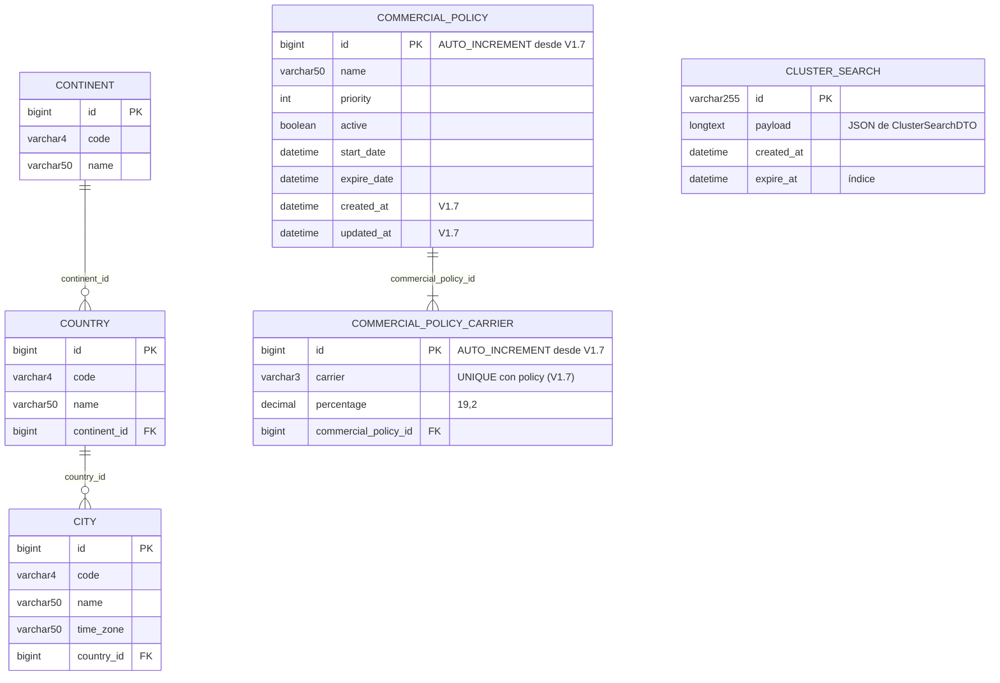

# Catálogo de APIs y entidades

Inventario de lo que el monolito expone (APIs propias), lo que consume (APIs de proveedores) y lo que persiste
(entidades y tablas). Verificado contra `controller/documentation/*`, `dto/*`, `model/*`, `application.yml` y las
migraciones `V1.0` a `V1.7`. Los términos están definidos en el [glosario](glosario.md).

Todas las rutas propias cuelgan del context path **`/api/flights`**.

---

## 1. Resumen

| API | Método y ruta | Módulo | Auth | Interfaz Swagger |
|-----|---------------|--------|------|------------------|
| Búsqueda | `GET /clusters/itineraries` | D1 | — | `ClustersResources` |
| Búsqueda | `GET /clusters/{id}/itineraries/{itineraryId}` | D1/D6 | — | `ClustersResources` |
| Pricing | `GET /pricing/commercial-policies` | D4 | `X-Api-Key` | `CommercialPolicyResources` |
| Pricing | `GET /pricing/commercial-policies/{id}` | D4 | `X-Api-Key` | `CommercialPolicyResources` |
| Pricing | `POST /pricing/commercial-policies` | D4 | `X-Api-Key` | `CommercialPolicyResources` |
| Pricing | `PUT /pricing/commercial-policies/{id}` | D4 | `X-Api-Key` | `CommercialPolicyResources` |
| Pricing | `PATCH /pricing/commercial-policies/{id}/status` | D4 | `X-Api-Key` | `CommercialPolicyResources` |
| Pricing | `DELETE /pricing/commercial-policies/{id}` | D4 | `X-Api-Key` | `CommercialPolicyResources` |
| Pricing | `PUT /pricing/commercial-policies/{id}/carriers/{carrier}` | D4 | `X-Api-Key` | `CommercialPolicyResources` |
| Pricing | `DELETE /pricing/commercial-policies/{id}/carriers/{carrier}` | D4 | `X-Api-Key` | `CommercialPolicyResources` |
| Soporte | `GET /documentation` → redirige a `swagger-ui/index.html` | I | — | oculto (`@Hidden`) |
| Soporte | `GET /actuator/health`, `/actuator/info`, `/actuator/metrics` | I | — | Spring Actuator |
| Proveedor | `GET {alpha-host}/itineraries` | D2 | — | contrato Microcks |
| Proveedor | `GET {beta-host}/itineraries` | D2 | — | contrato Microcks |
| Proveedor | `GET {gamma-host}/itineraries` | D2 | — | contrato Microcks |

Swagger UI: `/api/flights/documentation`, con dos grupos: `default` y `pricing`.

---

## 2. API pública de búsqueda

### 2.1 `GET /clusters/itineraries`

Hace una búsqueda nueva (sin `id`) o devuelve otra página de una búsqueda guardada (con `id`).

| Parámetro | Tipo | Obligatorio | Validación (`AvailabilityRequestValidator`) | Error |
|-----------|------|-------------|---------------------------------------------|-------|
| `from` | lista de códigos separada por coma | sí | No vacío; cada código ≤ 3 caracteres y existente en el catálogo con país y continente | 40001, 40011, 40014 |
| `to` | lista de códigos separada por coma | sí | Ídem; origen ≠ destino por ruta; rutas no duplicadas | 40002, 40011, 40012, 40013, 40014 |
| `departure` | lista de fechas `yyyy-MM-dd` | sí | Formato válido, no en el pasado, en orden no decreciente | 40003, 40007, 40008, 40009 |
| `adults` | entero | sí | > 0; adultos + niños ≤ 9 | 40004, 40010 |
| `children` | entero | sí (Swagger) | ≥ 0 | 40005 |
| `infants` | entero | sí (Swagger) | ≥ 0 (no cuentan para el tope de 9) | 40006 |
| `amount` | entero | no | Sin validación | — |
| `cabin` | `ECONOMY`, `PREMIUM_ECONOMY`, `BUSINESS` | no (default `ECONOMY`) | Valor del enum, sin importar mayúsculas | 40018 |
| `id` | texto | no | Id de una búsqueda previa | 502 + 40015 si no está |
| `offset` | entero (número de página) | no | Sin validación | — |
| `sortBy` | `PRICE`, `CARRIER`, `DURATION` | no (default `PRICE`) | Valor del enum | 40016 |
| `sortOrder` | `ASC`, `DESC` | no (default `ASC`) | Valor del enum | 40017 |
| `maxStops` | entero | no | ≥ 0 | 40019 |
| `minPrice`, `maxPrice` | decimal | no | ≥ 0 y `min ≤ max` | 40020 |
| `carriers`, `excludedCarriers` | lista de códigos | no | Cada código `[A-Z0-9]{2}` (normalizado a mayúsculas) | 40021 |
| `departureTime` | `NIGHT`, `MORNING`, `AFTERNOON`, `EVENING` | no | Valor del enum | 40022 |
| `checkedBaggage` | boolean | no | — | — |

Respuesta `200` — `ClusterSearchDTO`:

```json
{
  "id": "TWA_g=2026-11-15T10:00:00.123_f=BUE,MIA_t=MIA,BUE_d=2026-12-10,2026-12-20_a=1_c=1_i=0_cb=ECONOMY",
  "pagination": { "offset": 0, "limit": 10, "total": 37 },
  "itineraries": [
    {
      "id": "<id del proveedor>",
      "provider": "ALPHA",
      "flightType": "ROUND_TRIP",
      "carrier": "AR",
      "cabin": "ECONOMY",
      "segments": [
        {
          "flightDuration": "09:05",
          "legs": [
            {
              "origin": "BUE", "destination": "MIA",
              "departureDate": "2026-12-10", "departureTime": "22:30",
              "arrivalDate": "2026-12-11", "arrivalTime": "06:35",
              "number": 1302, "flightDuration": "09:05"
            }
          ]
        }
      ],
      "priceInfo": {
        "adults":   { "type": "ADULT", "quantity": 1, "base": 500.00, "tax": 100.00, "subtotal": 600.00,
                      "markup": { "percentage": 5, "amount": 300.00 }, "total": 900.00 },
        "children": { "type": "CHILD", "quantity": 1, "...": "..." }
      },
      "baggage": {
        "carryOn": { "pieces": 1, "weightKg": 8 },
        "checked": { "pieces": 1, "weightKg": 23 }
      }
    }
  ]
}
```

> El ejemplo es ilustrativo (los valores no salen de una corrida real). Muestra el efecto del markup `/10`: 5 → 50 %.
> `children` e `infants` no aparecen si la cantidad es 0.

### 2.2 `GET /clusters/{id}/itineraries/{itineraryId}`

Devuelve un itinerario de una búsqueda guardada, con el precio final que se calculó en la búsqueda.

| Respuesta | Cuándo |
|-----------|--------|
| `200` `ItineraryDTO` | La búsqueda existe, no venció y contiene el itinerario |
| `404` código `40401` | La búsqueda no existe, venció o todavía no se guardó |
| `404` código `40402` | El itinerario no está en la búsqueda |

### 2.3 Formato de error

`ErrorDTO`:

```json
{ "code": 40009, "shortDescription": "you cannot make a search in the past", "reasons": null }
```

- `BadRequestException` → siempre `400`, `shortDescription` = mensaje del enum.
- `APIException` → el status que indique quien la lanza; `shortDescription` y `reasons` pueden venir `null`
  (por ejemplo en `40015`).
- Cualquier otra excepción no está mapeada: responde el error por defecto de Spring (500) **(deducido del código, no
  probado)**.

### 2.4 Códigos de error

Definidos en `enums.ExceptionStatus`. En Java se escriben con guion bajo (`400_15`), en el JSON llegan como número
(`40015`).

| Código | Nombre | HTTP | Módulo | Mensaje |
|--------|--------|------|--------|---------|
| 40001 | `EMPTY_ORIGINS` | 400 | D1 | From must have a value |
| 40002 | `EMPTY_DESTINATIONS` | 400 | D1 | To must have a value |
| 40003 | `EMPTY_DEPARTURES` | 400 | D1 | Departures must have a value |
| 40004 | `INVALID_ADULTS_QUANTITY` | 400 | D1 | Adults value must be higher than zero |
| 40005 | `INVALID_CHILDREN_QUANTITY` | 400 | D1 | Children must have a positive value |
| 40006 | `INVALID_INFANT_QUANTITY` | 400 | D1 | Infants must have a positive value |
| 40007 | `INVALID_DEPARTURES` | 400 | D1 | Departure must have a valid format |
| 40008 | `ARRIVAL_BEFORE_DEPARTURE` | 400 | D1 | Arrival date es before departure date |
| 40009 | `SEARCH_IN_THE_PAST` | 400 | D1 | you cannot make a search in the past |
| 40010 | `INVALID_NUMBER_OF_PASSENGERS` | 400 | D1 | Invalid number of passengers. Maximum 9 |
| 40011 | `INVALID_ORIGIN_OR_DESTINATION` | 400 | D1 | At least one origin or destination have an invalid code |
| 40012 | `ORIGIN_AND_DESTINATION_ARE_THE_SAME` | 400 | D1 | Origin and destination are the same |
| 40013 | `DUPLICATED_ROUTES` | 400 | D1 | Some of the routes are duplicated |
| 40014 | `INCOMPLETE_CATALOG_INFORMATION` | 400 | D1/D5 | The information about one of the city is not complete |
| 40015 | `SEARCH_NOT_FOUND_IN_REPOSITORY` | **502** | D6 | The information about the search is not available |
| 40016 | `INVALID_SORT_CRITERIA` | 400 | D1 | The sort criteria must be one of PRICE, CARRIER or DURATION |
| 40017 | `INVALID_SORT_ORDER` | 400 | D1 | The sort order must be ASC or DESC |
| 40018 | `INVALID_CABIN` | 400 | D1 | The cabin must be one of ECONOMY, PREMIUM_ECONOMY or BUSINESS |
| 40019 | `INVALID_MAX_STOPS` | 400 | D1 | The maximum number of stops must be zero or a positive value |
| 40020 | `INVALID_PRICE_RANGE` | 400 | D1 | The prices must be positive values and the minimum can not be higher than the maximum |
| 40021 | `INVALID_CARRIERS` | 400 | D1 | The carriers must be codes of two characters comma separated |
| 40022 | `INVALID_DEPARTURE_TIME` | 400 | D1 | The departure time must be one of NIGHT, MORNING, AFTERNOON or EVENING |
| 40023 | `INVALID_POLICY_NAME` | 400 | D4 | The name is required and it can have at most 50 characters |
| 40024 | `INVALID_POLICY_PRIORITY` | 400 | D4 | The priority is required and it must be zero or a positive value |
| 40025 | `INVALID_POLICY_DATES` | 400 | D4 | The start and expire dates are required and the start must be before the expiration |
| 40026 | `INVALID_POLICY_CARRIERS` | 400 | D4 | The policy must have at least one carrier and they can not be duplicated |
| 40027 | `INVALID_POLICY_CARRIER_CODE` | 400 | D4 | The carrier must be a code of two characters |
| 40028 | `INVALID_POLICY_PERCENTAGE` | 400 | D4 | The percentage is required and it must be between 0 and 100 |
| 40029 | `INVALID_POLICY_STATUS` | 400 | D4 | The status of the policy is required |
| 40101 | `UNAUTHORIZED` | 401 | D4 | The API key is missing or it is invalid |
| 40401 | `SEARCH_NOT_FOUND` | 404 | D6 | The search does not exist or it is expired |
| 40402 | `ITINERARY_NOT_FOUND` | 404 | D6 | The itinerary does not exist in the search |
| 40403 | `POLICY_NOT_FOUND` | 404 | D4 | The commercial policy does not exist |
| 40404 | `CARRIER_NOT_FOUND_IN_POLICY` | 404 | D4 | The carrier does not exist in the commercial policy |

---

## 3. API de administración de pricing

Todas las rutas `/pricing/**` pasan por `PricingApiKeyInterceptor`: sin header `X-Api-Key` igual a `pricing.api-key`
responde `401` con código `40101`.

| Operación | Cuerpo | Respuesta OK | Errores |
|-----------|--------|--------------|---------|
| `GET /pricing/commercial-policies?active=&carrier=` | — | `200` lista de `CommercialPolicyDTO`, ordenada por prioridad descendente y luego por id | 401 |
| `GET /pricing/commercial-policies/{id}` | — | `200` `CommercialPolicyDTO` | 401, 404 (40403) |
| `POST /pricing/commercial-policies` | `CommercialPolicyRequestDTO` | `201` + header `Location` | 400 (40023-40028), 401 |
| `PUT /pricing/commercial-policies/{id}` | `CommercialPolicyRequestDTO` (reemplaza todo, incluidos los carriers) | `200` | 400, 401, 404 |
| `PATCH /pricing/commercial-policies/{id}/status` | `{"active": true}` | `200` | 400 (40029), 401, 404 |
| `DELETE /pricing/commercial-policies/{id}` | — | `204` (borra también sus carriers) | 401, 404 |
| `PUT /pricing/commercial-policies/{id}/carriers/{carrier}` | `{"percentage": 4}` | `200` (agrega o actualiza) | 400 (40027, 40028), 401, 404 |
| `DELETE /pricing/commercial-policies/{id}/carriers/{carrier}` | — | `200` | 400 (40026, último carrier), 401, 404 (40403, 40404) |

`CommercialPolicyRequestDTO` (ejemplo de Swagger):

```json
{
  "name": "Summer 2027",
  "priority": 20,
  "active": true,
  "startDate": "2026-12-01T00:00:00",
  "expireDate": "2027-03-01T00:00:00",
  "carriers": [ { "carrier": "AR", "percentage": 3 }, { "carrier": "LA", "percentage": 2 } ]
}
```

`CommercialPolicyDTO` agrega `id`, `createdAt` y `updatedAt`.

---

## 4. APIs consumidas: proveedores

Los tres connectors (`connector/*Connector`) hacen la misma llamada con `RestClient` y timeouts de 5 s de conexión y
lectura. Los contratos están en `microcks/provider-*-openapi.json` (generados con `microcks/generate-contracts.py`).

`GET {host}/itineraries`

| Query param | Valor que manda el monolito |
|-------------|-----------------------------|
| `origin` | primer código de `from` |
| `destination` | primer código de `to` |
| `departureDate` | primera fecha de `departure` |
| `returnDate` | segunda fecha de `departure`, si existe |
| `adults`, `children`, `infants` | tal cual vienen |
| `amount` | si viene en el pedido |
| `cabin` | `cabin` en mayúsculas o `ECONOMY` |

| Proveedor | Host (`application.yml`) | Respuesta (`dto/provider`) | Particularidades |
|-----------|--------------------------|----------------------------|------------------|
| Alpha | `PROVIDER_ALPHA_HOST`, default `http://localhost:8585/rest/provider-alpha/1.0` | `AlphaAvailabilityResponse(results: Offer[])` | camelCase; cabina `Y`/`W`/`C`; fechas `yyyy-MM-ddTHH:mm`; pasajeros `ADT`/`CHD`/`INF` |
| Beta | `PROVIDER_BETA_HOST`, default `.../provider-beta/1.0` | `BetaAvailabilityResponse(status, data.flight_options[])` | snake_case; `status` debe ser `OK`; precios en centavos; `bounds` con `OUTBOUND`/`INBOUND` |
| Gamma | `PROVIDER_GAMMA_HOST`, default `.../provider-gamma/1.0` | `GammaAvailabilityResponse(Itineraries[])` | PascalCase; vuelos agrupados por `SegmentIndex` y ordenados por `Sequence`; equipaje `1PC23KG`; cabina `ECO`/`PEY`/`BUS` |

Si el proveedor responde un status de error, el connector lanza `TWAException` y la búsqueda sigue sin ese proveedor.

---

## 5. Entidades y tablas

### 5.1 Diagrama entidad-relación



`CLUSTER_SEARCH` no tiene relaciones: su `payload` guarda una copia de códigos de ciudad, carriers y precios.

### 5.2 Detalle por entidad

| Entidad JPA | Tabla | Módulo | Migraciones | Detalles |
|-------------|-------|--------|-------------|----------|
| `Continent` (extiende `Base`) | `continent` | D5 | `V1.0` (crea), `V1.1` (datos) | `id` sin generación: lo asignan las migraciones |
| `Country` (extiende `Base`) | `country` | D5 | `V1.0`, `V1.1` | `@ManyToOne(cascade = ALL)` → `Continent` |
| `City` (extiende `Base`) | `city` | D5 | `V1.0`, `V1.1`, `V1.5` (más ciudades, llegó con el proveedor Gamma en f77c8a1) | `@ManyToOne(cascade = ALL)` → `Country`; `timeZone` IANA |
| `CommercialPolicy` | `commercial_policy` | D3/D4 | `V1.2` (crea), `V1.3` (datos), `V1.7` (auto-increment y auditoría) | `@OneToMany(cascade = ALL, orphanRemoval = true)` → carriers; `@PrePersist`/`@PreUpdate` llenan las fechas de auditoría |
| `CommercialPolicyCarrier` | `commercial_policy_carrier` | D3/D4 | `V1.2`, `V1.3`, `V1.6` (carriers de Gamma), `V1.7` (UNIQUE) | `carrier` admite 3 caracteres en la tabla; el validador exige 2 |
| `ClusterSearch` | `cluster_search` | D6 | `V1.4` | Se escribe asíncrono; `ClusterSearchCleanupJob` borra `expire_at < now` cada 60 s |

Diferencias entre el esquema y la entidad que conviene conocer:

- `commercial_policy.expire_date` es nullable en la tabla (`V1.2`) pero `nullable = false` en la entidad.
- Los códigos de `continent`, `country` y `city` admiten 4 caracteres; la API acepta como máximo 3.
- No hay índice ni restricción única sobre `city.code`, aunque es la clave de búsqueda (`CityRepository.findByCode`).

### 5.3 Datos semilla relevantes

| Política (`V1.3`) | Prioridad | Vigencia | Carriers (porcentaje) |
|-------------------|-----------|----------|-----------------------|
| 1 · General | 10 | 2024-01-01 → 2030-01-01 | AR 5, AA 2, IB 2, AL 1, AF 0, BA 3, DL 4, KL 1, LH 8, QF 7 + (`V1.6`) CM 3, AV 4, G3 2, JA 1, H2 1 |
| 2 · Special Carrier | 5 | 2024-01-01 → 2027-05-01 | AR 10, AA 1, IB 3, AL 1 |
| 3 · Ciber Week | 1 | 2024-01-19 18:00 → 2029-08-26 | AF 0, BA 1, DL 2, KL 0, LH 6, QF 5 |

Catálogo: `V1.1` carga continentes, países y ciudades base; `V1.5` agrega más ciudades (commit f77c8a1, junto con el proveedor Gamma).

---

## 6. DTOs del contrato público

| DTO | Usado en | Campos |
|-----|----------|--------|
| `ClustersAvailabilityRequestDTO` (extiende `AvailabilityRequestDTO`) | Request de búsqueda | `from`, `to`, `departure`, `adults`, `children`, `infants`, `amount`, `cabin` + `id`, `offset`, `sortBy`, `sortOrder`, `maxStops`, `minPrice`, `maxPrice`, `carriers`, `excludedCarriers`, `departureTime`, `checkedBaggage` |
| `ClusterSearchDTO` | Respuesta de búsqueda y `payload` de `cluster_search` | `id`, `pagination`, `itineraries` |
| `PaginationDTO` | Respuesta de búsqueda | `offset` (página), `limit`, `total` |
| `ItineraryDTO` | Búsqueda, detalle, pricing, proveedores | `id`, `provider`, `flightType`, `carrier`, `cabin`, `segments`, `priceInfo`, `baggage` |
| `SegmentDTO` / `LegDTO` | Dentro de `ItineraryDTO` | ver [glosario](glosario.md#1-modelo-del-itinerario) |
| `PriceInfoDTO` / `PaxPriceDTO` / `MarkupDTO` | Dentro de `ItineraryDTO` | `adults`/`children`/`infants`; `type`, `quantity`, `base`, `tax`, `subtotal`, `markup`, `total` |
| `BaggageDTO` / `BaggageAllowanceDTO` | Dentro de `ItineraryDTO` | `carryOn`/`checked`; `pieces`, `weightKg` |
| `CommercialPolicyRequestDTO` / `CommercialPolicyDTO` / `CommercialPolicyCarrierDTO` / `CommercialPolicyStatusDTO` | API de pricing | ver sección 3 |
| `ErrorDTO` | Todas | `code`, `shortDescription`, `reasons` |
| `UpdatedPriceInfoDTO` / `UpdatedPaxPriceDTO` | Interno de `PricingService` | no salen por la API |
| `CityDTO` / `CountryDTO` / `ContinentDTO` | Interno (`CatalogService`) | no salen por la API |

El JSON usa lowerCamelCase e ignora propiedades desconocidas (`WebConfiguration`).
