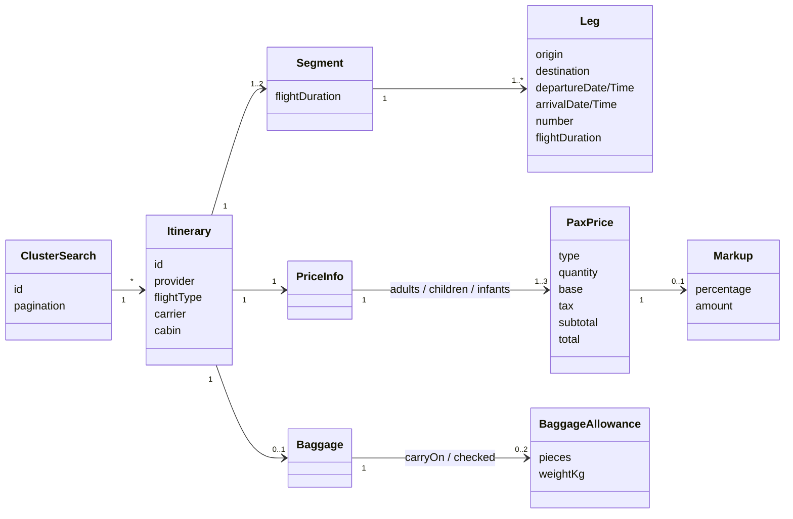

# Glosario del dominio

Términos que aparecen en el código, en la API y en las conversaciones con negocio. Para cada uno se indica el nombre
en el código, el módulo donde vive (ver [mapa de módulos](mapa-modulos-dependencias.md)) y las ambigüedades que hay
que resolver antes de separar contextos en la clase 3.

Módulos: **D1** Búsqueda · **D2** Proveedores · **D3** Pricing (cálculo) · **D4** Administración de pricing ·
**D5** Catálogo · **D6** Sesión de búsqueda · **K** Kernel compartido.

---

## 1. Modelo del itinerario

---

## 2. Términos

### Búsqueda (D1, D6)

| Término | En el código | Definición | Notas y ambigüedades |
|---------|--------------|------------|----------------------|
| **Búsqueda / Disponibilidad** (*availability*) | `ClustersService.availability`, `AvailabilityRequestDTO` | Pedido de vuelos para una ruta, fechas y cantidad de pasajeros. Devuelve itinerarios con precio final | "Availability" se usa tanto para la búsqueda pública como para la llamada a cada proveedor |
| **Cluster / Búsqueda guardada** (*cluster search*) | `ClusterSearchDTO`, `ClusterSearch`, tabla `cluster_search` | Resultado completo de una búsqueda (todos los itinerarios ya con precio), guardado para paginar y para consultar un itinerario | "Cluster" no significa agrupamiento de vuelos: es la búsqueda guardada |
| **Id de búsqueda** | `ClusterSearchDTO.id`, `FlightIdGeneratorHelper` | Texto que identifica la búsqueda guardada: `TWA_g=<fecha>_f=<from>_t=<to>_d=<departure>_a=_c=_i=_cb=<cabina>` | Codifica el pedido; no es un UUID |
| **TTL de la búsqueda** | `ClustersRepositoryImpl.TOKEN_TTL` | Tiempo de vida de la búsqueda guardada: 5 minutos | Fijo en el código |
| **Página / offset** | `PaginationDTO`, `ClustersAvailabilityRequestDTO.offset` | `offset` es el **número de página** (desde 0), `limit` el tamaño de la página, `total` la cantidad de itinerarios después de filtrar | No es un desplazamiento en cantidad de elementos |
| **Amount** | `AvailabilityRequestDTO.amount` | Tamaño de página **y** cantidad máxima de itinerarios que se toma de cada proveedor | Un mismo parámetro con dos significados |
| **Ruta** | `from`, `to`, `departure` (listas separadas por coma) | Par origen-destino con su fecha. Una búsqueda puede traer varias rutas | Solo la primera ruta llega a los proveedores (ver reglas ocultas) |
| **Filtro** | `ItineraryFilterHelper` | Restricción que se aplica sobre la búsqueda guardada en cada página: escalas, precio, carriers, franja horaria, equipaje | Se aplica después de guardar; cada página puede usar filtros distintos |
| **Orden** (*sort*) | `SortCriteria` (`PRICE`, `CARRIER`, `DURATION`), `SortOrder` (`ASC`, `DESC`) | Criterio para ordenar los itinerarios; el desempate siempre es por precio | Por defecto `PRICE ASC` |
| **Escalas** (*stops*) | `maxStops`, `ItineraryFilterHelper.getStops` | Cantidad de conexiones de un segmento: tramos − 1. La del itinerario es la del segmento con más conexiones | |
| **Franja horaria de salida** | `DepartureTimeRange` (`NIGHT` 0-6, `MORNING` 6-12, `AFTERNOON` 12-18, `EVENING` 18-24) | Rango de hora de salida del primer tramo de la ida | Inicio inclusivo, fin exclusivo. Hora local del aeropuerto |
| **Deduplicación** | `FlightDuplicationCheckHelper`, `ItineraryKeyGeneratorHelper` | Quitar itinerarios repetidos del mismo proveedor, quedándose con el más barato | La clave incluye el proveedor: no deduplica entre proveedores |

### Itinerario y vuelo (K, D2)

| Término | En el código | Definición | Notas y ambigüedades |
|---------|--------------|------------|----------------------|
| **Itinerario** (*itinerary*, *offer*, *option*) | `ItineraryDTO` | Una opción de viaje vendible: segmentos, precio, carrier, cabina y equipaje, que viene de un proveedor | Alpha la llama *offer*, Beta *flight option*, Gamma *itinerary*. Su `id` es el id que manda el proveedor |
| **Segmento** (*segment*, *journey*, *bound*) | `SegmentDTO` | Un sentido del viaje: la ida o la vuelta. Tiene uno o más tramos | Alpha: *journey*; Beta: *bound* (`OUTBOUND`/`INBOUND`); Gamma: `segmentIndex` (0 ida, 1 vuelta) |
| **Tramo** (*leg*, *flight*) | `LegDTO` | Un vuelo puntual entre dos aeropuertos, con número de vuelo | Alpha y Gamma lo llaman *flight*, Beta *leg* |
| **Número de vuelo** | `LegDTO.number` | Número de vuelo sin el código de aerolínea (`AR1234` → `1234`) | Se guardan solo los dígitos |
| **Duración** (*flight duration*) | `LegDTO.flightDuration`, `SegmentDTO.flightDuration` | Tiempo entre salida y llegada en formato `HH:mm`, calculado con la zona horaria de cada ciudad | Lo calcula el monolito, no el proveedor |
| **Tipo de vuelo** | `FlightType` (`ONE_WAY`, `ROUND_TRIP`, `MULTIPLE_DESTINATIONS`) | Solo ida o ida y vuelta | Se deduce de la **cantidad de destinos**. `MULTIPLE_DESTINATIONS` existe en el enum pero nunca se asigna |
| **Carrier / Aerolínea** (*validating carrier*, *marketing carrier*) | `ItineraryDTO.carrier` | Código de 2 caracteres de la aerolínea que vende el itinerario. Es la clave para buscar la política comercial | Alpha: `airline.code`; Beta: `marketing_carrier`; Gamma: `ValidatingCarrier`. No hay maestro de aerolíneas |
| **Cabina** (*cabin class*) | `CabinClass` (`ECONOMY`, `PREMIUM_ECONOMY`, `BUSINESS`) | Clase de servicio pedida y devuelta | Alpha usa códigos de reserva (`Y`/`W`/`C`), Gamma `ECO`/`PEY`/`BUS`, Beta el nombre |
| **Equipaje** (*baggage allowance*) | `BaggageDTO` (`carryOn`, `checked`), `BaggageAllowanceDTO` (`pieces`, `weightKg`) | Franquicia de equipaje de mano y despachado | "Con equipaje" = despachado con `pieces > 0`. Sin piezas, el peso se descarta |
| **Proveedor** (*provider*) | `Provider` (`ALPHA`, `BETA`, `GAMMA`), `ProviderFacade` | Sistema externo que devuelve la disponibilidad, cada uno con su formato | Simulados con Microcks |

### Pasajeros y precio (K, D3)

| Término | En el código | Definición | Notas y ambigüedades |
|---------|--------------|------------|----------------------|
| **Tipo de pasajero** | `PassengerType` (`ADULT`, `CHILD`, `INFANT`) | Adulto, niño o infante | Alpha: `ADT`/`CHD`/`INF`; Gamma: `ADULT`/`CHILD`/`INFANT`; Beta: `adult`/`child`/`infant` |
| **Tarifa** (*fare*) | `ProviderMapperHelper.Fare(base, tax)` | Precio unitario por pasajero que manda el proveedor: base e impuestos | Beta la manda en centavos |
| **Base / Impuestos** | `PaxPriceDTO.base`, `tax` | Precio unitario sin impuestos y monto de impuestos | |
| **Subtotal** | `PaxPriceDTO.subtotal` | `(base + tax) × cantidad` de ese tipo de pasajero | Es la base del markup |
| **Markup** | `MarkupDTO` (`percentage`, `amount`) | Recargo comercial que se suma al subtotal según la política del carrier | El monto es `subtotal × percentage / 10`, no `/100` (ver reglas ocultas) |
| **Total** | `PaxPriceDTO.total`, `PriceInfoDTO.getTotalAmount()` | Por tipo de pasajero: subtotal + markup. Del itinerario: suma de los tres tipos | Es el precio que se filtra y ordena |
| **Pricing** | `PricingService` | Proceso de elegir la política y aplicar el markup a cada itinerario | Itinerario sin política = no se vende |

### Políticas comerciales (D3, D4)

| Término | En el código | Definición | Notas y ambigüedades |
|---------|--------------|------------|----------------------|
| **Política comercial** (*commercial policy*) | `CommercialPolicy`, tabla `commercial_policy` | Conjunto de porcentajes de markup por carrier, con nombre, prioridad, estado y vigencia | Ejemplos semilla: "General", "Special Carrier", "Ciber Week" |
| **Carrier de la política** (*validating carrier*) | `CommercialPolicyCarrier`, tabla `commercial_policy_carrier` | Porcentaje de markup de un carrier dentro de una política. Un carrier aparece una sola vez por política | La columna admite 3 caracteres, el validador exige 2 |
| **Porcentaje** | `CommercialPolicyCarrier.percentage` | Valor que define el markup; se acepta entre 0 y 100 | Por el `/10`, un 5 es un 50 % |
| **Prioridad** | `CommercialPolicy.priority` | Desempate cuando varias políticas aplican al mismo carrier: **gana el número más alto** | Contraintuitivo; pregunta abierta para negocio |
| **Vigencia** | `startDate`, `expireDate` | Rango en el que la política aplica, comparado con las fechas del vuelo (no con la fecha de compra) | Hora local, sin zona horaria |
| **Activa** | `CommercialPolicy.active` | Una política inactiva nunca se aplica | Por defecto se crea activa |
| **API key de pricing** | `X-Api-Key`, `PricingApiKeyInterceptor`, `pricing.api-key` | Clave compartida que protege `/pricing/**` | Una sola clave, sin usuarios ni roles |

### Catálogo (D5)

| Término | En el código | Definición | Notas y ambigüedades |
|---------|--------------|------------|----------------------|
| **Ciudad** | `City`, tabla `city` | Código (hasta 3 en la API, hasta 4 en la tabla), nombre, zona horaria y país | Los "códigos de ciudad" de la API son en la práctica códigos de ciudad/aeropuerto IATA (`BUE`, `MIA`) |
| **País** | `Country`, tabla `country` | Código, nombre y continente | |
| **Continente** | `Continent`, tabla `continent` | Código y nombre | |
| **Zona horaria** | `City.timeZone` | Id de zona IANA (por ejemplo `America/Argentina/Buenos_Aires`), usada para calcular duraciones | Si falta la ciudad, el itinerario se descarta |
| **Información de catálogo incompleta** | `INCOMPLETE_CATALOG_INFORMATION` (400_14) | La ciudad del pedido no existe o le falta país o continente | Cualquier error al consultar el catálogo da este código |

### Errores (K)

| Término | En el código | Definición |
|---------|--------------|------------|
| **Código de error** | `ExceptionStatus` | Número `SSS_NN`: los 3 primeros dígitos imitan el status HTTP y los 2 últimos el caso. Ver [catálogo](catalogo-apis-entidades.md#24-códigos-de-error) |
| **ErrorDTO** | `ErrorDTO` (`code`, `shortDescription`, `reasons`) | Cuerpo de las respuestas de error |

---

## 3. Mismo concepto, distintos nombres

| Concepto del monolito | Alpha | Beta | Gamma |
|-----------------------|-------|------|-------|
| Itinerario | `Offer` (`offerId`) | `FlightOption` (`option_id`) | `Itinerary` (`Key`) |
| Segmento | `Journey` | `Bound` (`direction`) | `Flight.SegmentIndex` |
| Tramo | `Flight` | `Leg` | `Flight` (`Sequence`) |
| Carrier | `airline.code` | `marketing_carrier` | `ValidatingCarrier` |
| Cabina | `cabinClass` = `Y`/`W`/`C` | `cabin` = nombre | `CabinType` = `ECO`/`PEY`/`BUS` |
| Pasajero | `ADT`/`CHD`/`INF` | `adult`/`child`/`infant` | `ADULT`/`CHILD`/`INFANT` |
| Precio | `base`, `taxes` | `base_fare_cents`, `tax_cents` (centavos) | `BaseAmount`, `TaxAmount` |
| Equipaje | `luggage.cabin/hold` (`pieces`, `maxWeightKg`) | `hand_pieces`, `hand_kg`, `checked_pieces`, `checked_kg` | `Bags.CarryOn/Checked` = `1PC23KG` |
| Fecha y hora | `yyyy-MM-ddTHH:mm` | fecha y hora separadas | `yyyy-MM-ddTHH:mm:ss` |
| Convención JSON | camelCase | snake_case | PascalCase |

---

## 4. Términos ambiguos a resolver en la clase 3

1. **"Carrier"** significa a la vez aerolínea que vende (*validating/marketing carrier*) y fila de una política. No
   existe un maestro de aerolíneas: el código es la única referencia.
2. **"Cluster"** es la búsqueda guardada, no una agrupación de vuelos.
3. **"Amount"** es tamaño de página y tope por proveedor.
4. **"Offset"** es número de página.
5. **"Percentage"** no es un porcentaje real mientras se divida por 10.
6. **"Ciudad"** se usa para lo que en realidad son códigos IATA de ciudad o aeropuerto.
7. **"Availability"** nombra la búsqueda pública y la llamada a cada proveedor.
