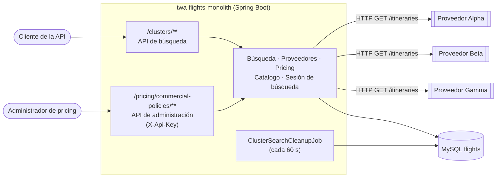
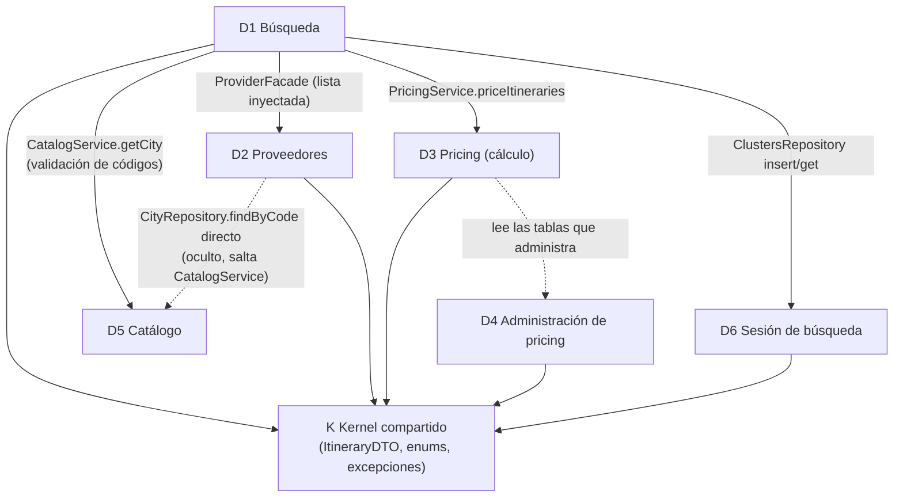
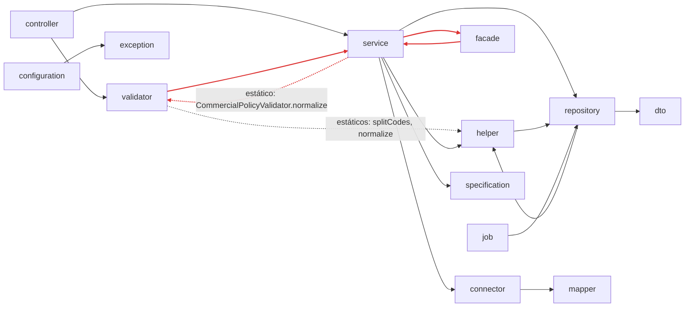
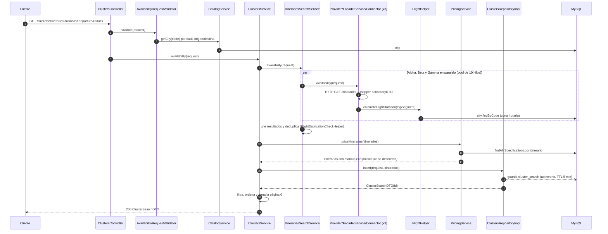
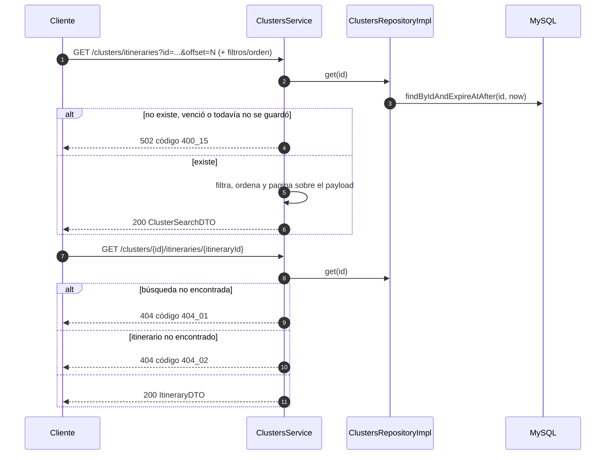
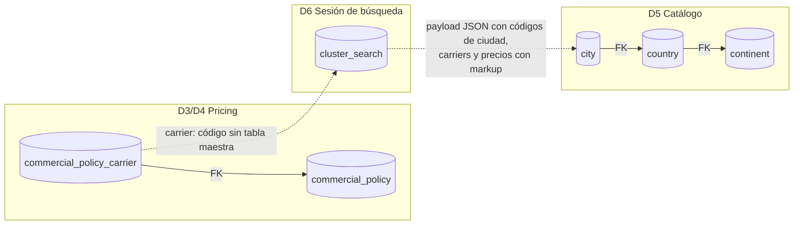
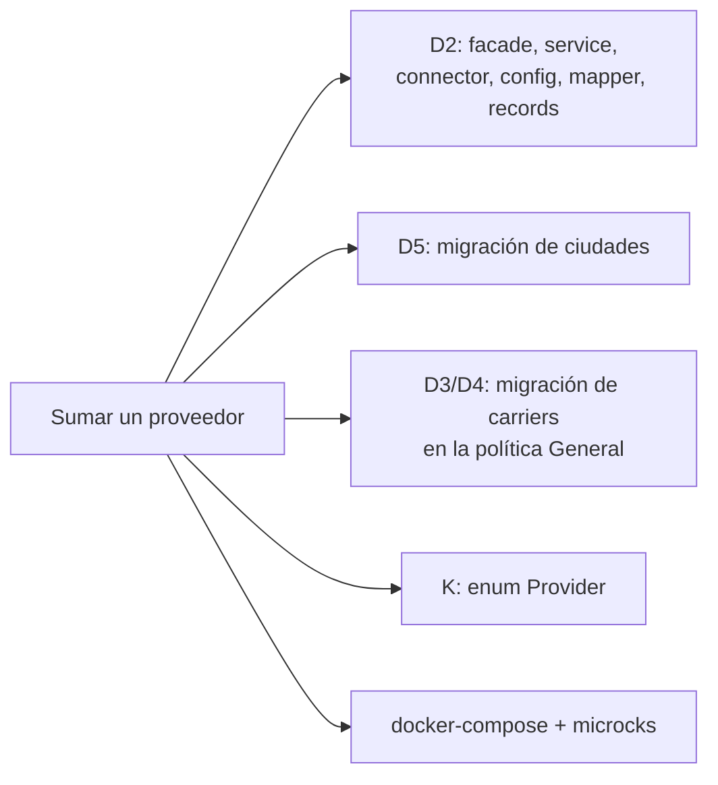

# Mapa de módulos y dependencias

Base para decidir dónde cortar el monolito (clase 3). Sale del [informe de investigación](informe-investigacion.md)
revisado y se volvió a verificar contra `src/main` y las migraciones `V1.0` a `V1.7`. Lo que no se pudo confirmar en el
código está marcado como **(hipótesis)**.

> Convención de rutas: las clases están en `src/main/java/com/twa/flights/`. Se nombran por paquete y clase.

---

## 1. Vista general

El monolito es una sola aplicación Spring Boot con una sola base MySQL (`flights`). Expone dos APIs (búsqueda pública y
administración de pricing) y consume tres proveedores externos simulados en Microcks.

---

## 2. Módulos lógicos

El código está organizado por capa técnica (`controller`, `service`, `helper`...), no por dominio. Los módulos de esta
tabla son **lógicos**: agrupan clases de distintos paquetes según la responsabilidad.

| Id | Módulo | Clases | Responsabilidad | Tablas |
|----|--------|--------|-----------------|--------|
| D1 | **Búsqueda / Disponibilidad** | `controller.ClustersController`, `validator.AvailabilityRequestValidator`, `service.ClustersService`, `service.ItinerariesSearchService`, `helper.FlightDuplicationCheckHelper`, `helper.ItineraryKeyGeneratorHelper`, `helper.ItineraryFilterHelper`, `helper.ItinerarySortHelper` | Valida el pedido, llama a los proveedores en paralelo, une y deduplica, pide el precio, filtra, ordena y pagina | — (usa D6) |
| D2 | **Integración con proveedores** (capa anticorrupción) | `facade.Provider{Alpha,Beta,Gamma}Facade`, `service.Provider{Alpha,Beta,Gamma}Service`, `connector.{Alpha,Beta,Gamma}Connector`, `connector.configuration.*`, `mapper.provider.*`, `dto.provider.*` (records), `helper.FlightHelper` | Hace el HTTP a cada proveedor, traduce su formato a `ItineraryDTO` y calcula la duración de tramos y segmentos | Lee `city` (vía `FlightHelper`) |
| D3 | **Pricing (cálculo)** | `service.PricingService`, `specification.CommercialPolicyCarrierSpecification` | Elige la política comercial vigente para cada itinerario y le aplica el markup | Lee `commercial_policy`, `commercial_policy_carrier` |
| D4 | **Administración de políticas comerciales** | `controller.CommercialPolicyController`, `service.CommercialPolicyService`, `validator.CommercialPolicyValidator`, `mapper.CommercialPolicyMapper`, `configuration.PricingApiKeyInterceptor` | CRUD de políticas y de sus carriers, protegido con `X-Api-Key` | Escribe `commercial_policy`, `commercial_policy_carrier` |
| D5 | **Catálogo geográfico** | `service.CatalogService`, `repository.CityRepository`, `model.{City,Country,Continent}`, `mapper.CityMapper` | Ciudades con zona horaria, país y continente. Solo lectura: se carga con migraciones | `continent`, `country`, `city` |
| D6 | **Sesión de búsqueda** (caché de resultados) | `repository.impl.ClustersRepositoryImpl`, `repository.ClusterSearchJpaRepository`, `model.ClusterSearch`, `job.ClusterSearchCleanupJob`, `serializer.JsonSerializer`, `helper.FlightIdGeneratorHelper` | Guarda el resultado completo de la búsqueda como JSON durante 5 minutos para paginar y para `getItinerary` | `cluster_search` |
| K | **Kernel compartido** | `dto.*` (sobre todo `ItineraryDTO`, `SegmentDTO`, `LegDTO`, `PriceInfoDTO`, `PaxPriceDTO`), `enums.*`, `exception.*` | Modelo y errores que usan todos los módulos | — |
| I | **Infraestructura transversal** | `configuration.WebConfiguration`, `configuration.SwaggerConfiguration`, `controller.DocumentationController`, `service.AppInfoService`, `FlightsApplication`, `application.yml` | Jackson, interceptor de pricing, Swagger, info de la app | — |

**Lectura del equipo:**

- D3 y D4 comparten entidades y tablas: son un mismo contexto (**Pricing**) con dos caras, cálculo y administración
  **(hipótesis de diseño, a confirmar en la clase 3)**.
- D6 está muy pegado a D1: es más un detalle de infraestructura de la búsqueda que un dominio aparte.
- D5 es el candidato natural para la primera extracción (es de solo lectura y tiene pocas dependencias entrantes), pero
  tiene un acoplamiento oculto desde D2 (ver 4.1).

---

## 3. Dependencias entre módulos

Las flechas punteadas son dependencias **por datos** o que saltean la interfaz del módulo.

| Desde | Hacia | Cómo | Tipo |
|-------|-------|------|------|
| D1 | D2 | `ItinerariesSearchService` recibe `List<ProviderFacade>` y los llama en un thread pool propio | Llamada síncrona en paralelo |
| D1 | D5 | `AvailabilityRequestValidator` → `CatalogService.getCity` por cada código de origen y destino | Llamada |
| D1 | D3 | `ClustersService` → `PricingService.priceItineraries(List<ItineraryDTO>)` | Llamada; **modifica la lista en el lugar** |
| D1 | D6 | `ClustersService` → `ClustersRepository.insert/get` (la interfaz recibe y devuelve DTOs de la API) | Llamada |
| D2 | D5 | `FlightHelper` → `CityRepository.findByCode` (2 consultas por tramo y 2 por segmento) | **Acceso directo al repositorio de otro módulo** |
| D3 | D4 | `PricingService` lee con `CommercialPolicyRepository` las mismas entidades que escribe `CommercialPolicyService` | Tablas compartidas |
| D3 | K | `PricingService` y la `Specification` reciben `ItineraryDTO`, el modelo de la búsqueda. Pricing no tiene contrato propio | Modelo compartido |

---

## 4. Dependencias entre paquetes (técnicas)

En rojo, los dos ciclos que hay que cortar antes de modularizar.

### 4.1 Puntos de acoplamiento a resolver

| # | Acoplamiento | Dónde | Por qué importa |
|---|--------------|-------|-----------------|
| A1 | **Ciclo `service` ↔ `facade`** | `ItinerariesSearchService` → `ProviderFacade`; `Provider*Facade` → `Provider*Service` | La fachada de proveedores vive "en medio" del paquete `service` |
| A2 | **Ciclo `service` ↔ `validator`** | `CommercialPolicyService` usa `CommercialPolicyValidator.normalize` (estático); `AvailabilityRequestValidator` usa `CatalogService` | Lógica de normalización compartida por un método estático |
| A3 | **`helper` accede a la base de otro módulo** | [`FlightHelper.calculateFlightDuration`](../../../src/main/java/com/twa/flights/helper/FlightHelper.java) → `CityRepository` (líneas 65-74) | Es el acoplamiento oculto más importante para extraer el catálogo: Proveedores necesita la zona horaria de cada ciudad |
| A4 | `validator` → `helper` (estáticos) | `AvailabilityRequestValidator` usa `ItineraryFilterHelper.splitCodes` e `ItinerarySortHelper.normalize` | Acoplamiento poco visible |
| A5 | `connector` → `mapper.provider` | Cada `*Connector` hace el HTTP **y** mapea la respuesta | El connector no devuelve el formato del proveedor sino el modelo interno |
| A6 | `repository` → `dto` y → `helper` | `ClustersRepository` trabaja con `ClusterSearchDTO`/`ItineraryDTO`; `ClustersRepositoryImpl` usa `FlightIdGeneratorHelper` | El repositorio conoce el contrato de la API |
| A7 | Modelo compartido y mutable | `ItineraryDTO` lo usan D1, D2, D3 y D6; `PricingService` modifica los `PaxPriceDTO` | Cualquier cambio del modelo toca todos los módulos |
| A8 | Enum de errores central | `enums.ExceptionStatus` (códigos de todos los módulos en un solo enum) | Es el archivo que más cambia junto con otros (6 commits) |

---

## 5. Flujo principal: búsqueda nueva

### Paginación y detalle (búsqueda guardada)

---

## 6. Datos por módulo

Todo está en una sola base, `flights`. No hay joins SQL entre módulos: el acoplamiento pasa por el código (A3) y por
referencias implícitas.

| Tabla | Módulo dueño (propuesto) | Escribe | Lee |
|-------|--------------------------|---------|-----|
| `continent`, `country`, `city` | D5 Catálogo | Solo migraciones (`V1.0`, `V1.1`, `V1.5`) | `CatalogService` (D1), **`FlightHelper` (D2)** |
| `commercial_policy`, `commercial_policy_carrier` | D3/D4 Pricing | `CommercialPolicyService` (D4), migraciones `V1.3`, `V1.6` | `PricingService` (D3) vía `CommercialPolicyCarrierSpecification` |
| `cluster_search` | D6 Sesión de búsqueda | `ClustersRepositoryImpl` (asíncrono) | `ClustersRepositoryImpl`; `ClusterSearchCleanupJob` borra |

El detalle de columnas está en el [catálogo de APIs y entidades](catalogo-apis-entidades.md#5-entidades-y-tablas).

---

## 7. Archivos que cambian juntos (git log)

| Grupo | Commits | Lectura |
|-------|---------|---------|
| `ExceptionStatus.java` | 1e5ccc1, 8176f5d, 7245208, b0ee16b, 6eddbb8, a868561 | El punto más caliente: entra en casi todas las features, de todos los módulos |
| `ClustersResources` + `ClustersAvailabilityRequestDTO` + `AvailabilityRequestValidator` + `ClustersService` + `README.md` | 8176f5d, 7245208, b0ee16b | Cada feature de búsqueda toca API, DTO, validador y servicio |
| `{Alpha,Beta,Gamma}Connector` + `Provider*ConnectorConfiguration` | d0b786a | Cirugía de escopeta: un fix de timeouts se replica 6 veces |
| `{Alpha,Beta,Gamma}ItineraryMapper` + `ProviderMapperHelper` | c0f5987, 7245208 | Ídem con los mappers |
| Proveedor nuevo: 13 archivos + `V1.5` (ciudades) + `V1.6` (pricing) + `docker-compose` + `microcks` | f77c8a1 | Sumar un proveedor obliga a tocar **Catálogo** y **Pricing** |
| `application.yml` | 5 commits | Configuración compartida por todos los módulos |
| `WebConfiguration` + `SwaggerConfiguration` | 1e5ccc1, a868561 | Infraestructura web transversal |

---

## 8. Configuración que afecta a varios módulos

| Propiedad (`application.yml`) | Valor local | Módulo |
|-------------------------------|-------------|--------|
| `server.servlet.context-path` | `/api/flights` | I |
| `connector.provider-{alpha,beta,gamma}.host` | `http://localhost:8585/rest/provider-*/1.0` | D2 |
| `connector.provider-*.connectionTimeout` / `readTimeout` | 5000 ms | D2 |
| `pricing.api-key` (`PRICING_API_KEY`) | `twa-pricing-local-key` | D4 |
| `jobs.cluster-search-cleanup.fixed-delay` | 60000 ms | D6 |
| `spring.datasource.*` (`DB_HOST`, `DB_PORT`...) | `localhost:3320/flights` | Todos |
| `spring.jpa.hibernate.ddl-auto` | `validate` (el esquema lo maneja Flyway) | Todos |

Valores fijos en el código (no configurables): TTL de la búsqueda (5 min, `ClustersRepositoryImpl.TOKEN_TTL`) y los dos
thread pools de 10 hilos (`ItinerariesSearchService`, `ClustersRepositoryImpl`).
