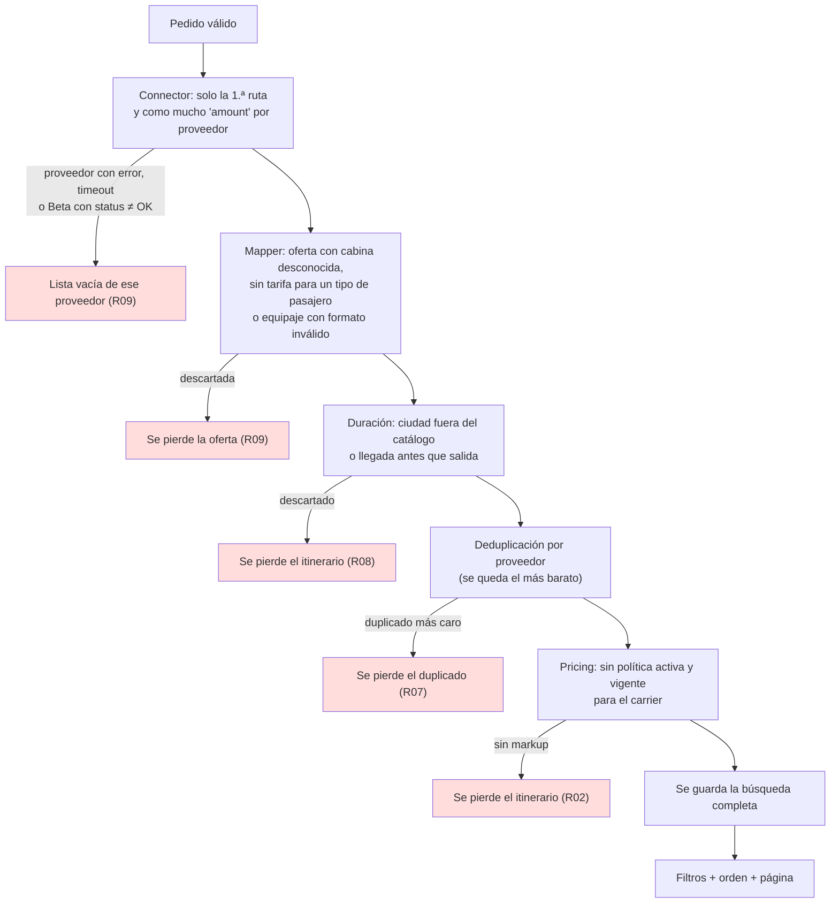

# Reglas ocultas

Reglas de negocio que el monolito aplica sin que estén documentadas en la API ni en el README. Son el comportamiento
que hay que **preservar** (o cambiar a conciencia, con negocio) en la migración, y la base de los tests de
caracterización de la clase 5.

**Ninguna se corrigió en el código:** el objetivo es caracterizar el sistema, no arreglarlo.

Estado de cada regla:

- **Verificada**: se lee en el código (se indica clase y método).
- **Deducida**: sale de leer el código, pero no se probó contra el stack levantado.
- **Hipótesis**: es una interpretación sobre intención o impacto, a confirmar con negocio.

Las rutas son relativas a `src/main/java/com/twa/flights/`.

---

## 1. Dónde se pierden itinerarios sin avisar

Varias reglas descartan itinerarios en silencio. Este es el embudo completo de una búsqueda nueva:

Ningún descarte llega al cliente como error ni como aviso: solo quedan en el log.

---

## 2. Pricing

### R01 · El markup se divide por 10, no por 100

- **Regla:** `markup = subtotal × (percentage / 10)`. Con AR = 5 en "General", el markup es el **50 %** del subtotal.
  El validador acepta porcentajes hasta 100, o sea hasta 10 veces el precio.
- **Evidencia:** `service/PricingService.calculateMarkupByType` (línea 123); `validator/CommercialPolicyValidator`
  (`MAX_PERCENTAGE = 100`).
- **Estado:** verificada. Que sea un bug o una regla del negocio es **hipótesis**.
- **Pregunta abierta:** ¿el porcentaje es `/100`? ¿Los precios publicados hoy son los correctos?

### R02 · Sin política aplicable, el itinerario no se vende

- **Regla:** si ninguna política activa y vigente incluye al carrier, el itinerario desaparece del resultado.
- **Evidencia:** `PricingService.priceItineraries`, filtro `getAdults().getMarkup() != null` (línea 53).
- **Estado:** verificada.
- **Impacto:** un carrier nuevo de un proveedor no aparece en la búsqueda hasta que alguien lo agrega a una política
  (por eso `V1.6` agregó los carriers de Gamma a "General").

### R03 · Gana la política con el número de prioridad más alto

- **Regla:** entre las políticas que aplican, se usa la de mayor `priority` (`orderBy desc` + primer resultado).
- **Evidencia:** `specification/CommercialPolicyCarrierSpecification.toPredicate` (línea 75) y
  `PricingService.calculatePrices` (`findFirst`).
- **Estado:** verificada.
- **Consecuencia con los datos semilla:** "General" (10) le gana a "Special Carrier" (5) y a "Ciber Week" (1) en todos
  los carriers que comparten. Ver R06.
- **Pregunta abierta:** ¿la intención es la contraria (1 = máxima prioridad)?

### R04 · Vigencia de la política según las fechas del vuelo

- **Regla:** la política aplica si `start_date ≤ salida del primer tramo de la ida` y
  `expire_date ≥ llegada del **primer** tramo del **último** segmento`. Se compara en hora local del aeropuerto, sin
  zona horaria, y no se usa la fecha de compra.
- **Evidencia:** `CommercialPolicyCarrierSpecification.convertArrival` usa `segment.firstLeg()`; se llama con
  `itinerary.lastSegment()` (línea 68).
- **Estado:** verificada.
- **Efecto:** en un vuelo con escalas no se mira la llegada final, sino la del primer tramo.
- **Pregunta abierta:** ¿la vigencia se define por fecha de salida, de llegada o de compra?

### R05 · El markup se aplica sobre los impuestos y es igual para todos los pasajeros

- **Regla:** `subtotal = (base + tax) × cantidad` y el markup se calcula sobre ese subtotal, con el mismo porcentaje
  para adultos, niños e infantes.
- **Evidencia:** `mapper/provider/ProviderMapperHelper.createPaxPrice`, `PricingService.calculateMarkup`.
- **Estado:** verificada.
- **Pregunta abierta:** ¿el markup debería excluir impuestos? ¿Niños e infantes tienen otro porcentaje?

### R06 · "Special Carrier" nunca se aplica (corrige el informe)

- **Regla:** todos los carriers de "Special Carrier" (AR, AA, IB, AL) también están en "General", que tiene más
  prioridad (10 > 5) y una vigencia que la cubre (hasta 2030-01-01). Por R03, mientras "General" esté activa, "Special
  Carrier" no se usa nunca. Lo mismo pasa con "Ciber Week" (prioridad 1): todos sus carriers están en "General".
- **Evidencia:** `V1.3__insert_pricing_rows.sql` + R03.
- **Estado:** verificada con los datos semilla.
- **Corrección al informe:** el informe decía que el día que vence "Special Carrier" (2027-05-01) cambian los precios
  sin deploy. No es así, por dos motivos: (1) con los datos semilla "Special Carrier" nunca gana (ver arriba), y
  (2) la vigencia se compara con las **fechas del vuelo**, no con la fecha de hoy (R04). Lo que sí pasa es que los
  vuelos que llegan después del **2030-01-01**, cuando vence "General", no tienen ninguna política vigente ("Special
  Carrier" vence en 2027 y "Ciber Week" en 2029-08-26) y por R02 no se venden, ya hoy **(deducido)**.

### R06b · Carriers de Gamma en la política "General" (corrige el informe)

- **Regla:** `V1.6` agrega **cinco** carriers a "General": CM 3, AV 4, G3 2, JA 1 y **H2 1** (el informe mencionaba
  cuatro).
- **Evidencia:** `V1.6__insert_pricing_rows_provider_gamma.sql`.
- **Estado:** verificada.

---

## 3. Búsqueda

### R07 · La deduplicación es por proveedor y antes del markup

- **Regla:** la clave de un itinerario es `proveedor | carrier @ [duración del segmento | tramos (origen-destino,
  número, fecha y hora de salida)]`. Si el mismo vuelo llega de Alpha y de Beta, **no se deduplica**. Dentro de un
  proveedor se queda el más barato y, si empatan, el primero que llegó. La clave **no incluye cabina, equipaje ni
  precio**: dos ofertas del mismo vuelo con distinta cabina colapsan en una. Se deduplica antes de aplicar el markup.
- **Evidencia:** `helper/ItineraryKeyGeneratorHelper.generateKeyForItinerary`,
  `helper/FlightDuplicationCheckHelper.removeDuplicateFlights`, orden de llamadas en `service/ClustersService`.
- **Estado:** verificada.
- **Pregunta abierta:** ¿se muestran las dos ofertas si el vuelo llega de dos proveedores? ¿Y dos cabinas del mismo
  vuelo?

### R08 · Si no se puede calcular la duración, el itinerario se descarta

- **Regla:** la duración se calcula con la zona horaria de las ciudades del catálogo. Si una ciudad no está en el
  catálogo, o si la llegada es anterior a la salida, el itinerario se descarta en silencio.
- **Evidencia:** `service/Provider{Alpha,Beta,Gamma}Service.calculateFlightDuration` (`catch (Exception e)`),
  `helper/FlightHelper.timeBetweenDateTime` (`val < 0`).
- **Estado:** verificada.
- **Impacto:** si al catálogo le falta una ciudad, los vuelos que pasan por ella desaparecen sin aviso. Alpha además
  no loguea la excepción (Beta y Gamma sí).

### R09 · Un proveedor que falla no rompe la búsqueda

- **Regla:** error HTTP, timeout o excepción de un proveedor → lista vacía de ese proveedor, sin error para el
  cliente. Beta con `status != "OK"` también devuelve vacío. Una oferta que no se puede mapear (cabina desconocida,
  falta la tarifa de un tipo de pasajero pedido, equipaje de Gamma con formato inválido) se descarta y el resto del
  proveedor sigue.
- **Evidencia:** `service/ItinerariesSearchService.makeProviderCalls`, `mapper/provider/BetaItineraryMapper.map`
  (línea 49), `mapper/provider/*ItineraryMapper.map` (`catch (RuntimeException e)`),
  `ProviderMapperHelper.createPaxPrice` (tarifa nula → excepción). Fix c0f5987.
- **Estado:** verificada.
- **Pregunta abierta:** ¿hay que avisar al usuario que los resultados están incompletos?

### R10 · Solo se busca la primera ruta

- **Regla:** a los proveedores se manda `from[0]`, `to[0]`, `departure[0]` y, si existe, `departure[1]` como fecha de
  vuelta. El tipo `ROUND_TRIP` se decide por **la cantidad de destinos**, no de fechas. `MULTIPLE_DESTINATIONS` nunca
  se asigna. El validador acepta varias rutas y solo valida que no se repitan ni tengan origen igual a destino.
- **Evidencia:** `connector/{Alpha,Beta,Gamma}Connector.availability` (línea 50),
  `ProviderMapperHelper.getFlightType` (línea 26).
- **Estado:** verificada.
- **Efecto:** `from=BUE&to=MIA,BUE&departure=2026-12-10` se marca `ROUND_TRIP` pero se busca solo ida **(deducido)**.
- **Pregunta abierta:** ¿se soportan multidestino o solo ida e ida y vuelta?

### R11 · Pasajeros: máximo 9 entre adultos y niños

- **Regla:** al menos 1 adulto; `adults + children ≤ 9`; los infantes no cuentan para el tope. No se valida un máximo
  de infantes por adulto.
- **Evidencia:** `validator/AvailabilityRequestValidator.validatePassengerCount` (líneas 153-163).
- **Estado:** verificada.
- **Detalle:** si `children` o `infants` no vienen, el validador compara un `Integer` nulo y la respuesta sería un 500
  **(deducido, no probado)**. El resto del código (`FlightIdGeneratorHelper`, `ProviderMapperHelper`) sí tolera nulos,
  y Swagger los marca como obligatorios.
- **Pregunta abierta:** ¿puede haber más de un infante por adulto? ¿El tope de 9 viene de las aerolíneas?

### R12 · Validación de ciudades contra el catálogo

- **Regla:** cada código puede tener hasta 3 caracteres y la ciudad debe existir con país y continente. Cualquier
  excepción al consultar el catálogo (ciudad inexistente, error de base) se informa como `40014
  INCOMPLETE_CATALOG_INFORMATION`, no como `40011` código inválido.
- **Evidencia:** `AvailabilityRequestValidator.validateCodeWithCatalog` (`catch (Exception e)`, línea 227).
- **Estado:** verificada.

### R13 · Fechas: no en el pasado y en orden

- **Regla:** las fechas no pueden ser anteriores a hoy (según el reloj y la zona del servidor) y deben estar en orden
  no decreciente: ida y vuelta el mismo día está permitido.
- **Evidencia:** `AvailabilityRequestValidator.validateDeparture`.
- **Estado:** verificada.

### R14 · Paginación: `offset` es número de página y `amount` tiene dos usos

- **Regla:** `skip = offset × pageSize`. Sin `amount`, todo va en una sola página. En una búsqueda nueva el `offset`
  se ignora: siempre devuelve la página 0. Además `amount` limita **cuántos itinerarios se toman de cada proveedor**
  (antes de deduplicar y de los descartes), así que el total puede ser menor que `3 × amount`.
- **Evidencia:** `service/ClustersService.buildPage` (línea 107), `availabilityFromProviders` (`buildPage(..., 0)`),
  `connector/*Connector` (línea 76).
- **Estado:** verificada.
- **Detalle:** si se pide una página con `id` pero sin `offset`, el `Integer` nulo se pasa a un `int` y la respuesta
  sería un 500 **(deducido, no probado)**.

### R15 · Filtros y orden se aplican en cada página sobre la búsqueda guardada

- **Regla:**
  - Se guardan todos los itinerarios; filtros y orden se aplican en cada pedido, y cada página puede usar otros.
  - **Escalas** = las del segmento con más conexiones.
  - **Franja horaria** = hora de salida del primer tramo de la ida, en hora local.
  - **Con equipaje** = equipaje despachado con `pieces > 0`. Sin piezas, el peso se descarta.
  - **Precio** de filtro y orden = total con markup de todos los pasajeros.
  - **Duración** para ordenar = suma de la duración de los segmentos (incluye el tiempo de escala).
  - En cualquier criterio el desempate es por precio; el orden por defecto es `PRICE ASC`.
  - La **cabina** no se filtra localmente: se manda al proveedor y se confía en lo que devuelve.
- **Evidencia:** `helper/ItineraryFilterHelper`, `helper/ItinerarySortHelper`,
  `ProviderMapperHelper.createAllowance`, `connector/*Connector` (param `cabin`).
- **Estado:** verificada.

### R16 · La búsqueda vive 5 minutos y se guarda en segundo plano

- **Regla:** el TTL es de 5 minutos, fijo en el código. El guardado es asíncrono (fire-and-forget). Si se pide la
  página siguiente enseguida y todavía no se guardó, o si ya venció, responde **HTTP 502 con código 40015**. El
  detalle de un itinerario en la misma situación responde 404 `40401`.
- **Evidencia:** `repository/impl/ClustersRepositoryImpl` (`TOKEN_TTL`, línea 29; `executorService.submit`, línea
  53), `ClustersService.availabilityFromDatabase` (línea 93), `job/ClusterSearchCleanupJob`.
- **Estado:** verificada en el código; el 502 no se probó contra el stack.
- **Pregunta abierta:** ¿alcanzan 5 minutos? ¿Qué pasa con un itinerario elegido cuando la búsqueda venció?

### R17 · El id de búsqueda codifica el pedido

- **Regla:** `TWA_g=<fecha y hora>_f=<from>_t=<to>_d=<departure>_a=<adultos>_c=<niños>_i=<infantes>_cb=<cabina>`. No
  incluye filtros, orden ni `amount`.
- **Evidencia:** `helper/FlightIdGeneratorHelper.generate`.
- **Estado:** verificada. Dos búsquedas iguales en el mismo instante colisionan **(hipótesis, poco probable)**.

### R18 · El id del itinerario es el del proveedor

- **Regla:** `ItineraryDTO.id` es el `offerId`/`option_id`/`Key` del proveedor, sin prefijo. Si dos proveedores
  devolvieran el mismo id, `getItinerary` devolvería el primero que encuentre **(hipótesis)**.
- **Evidencia:** `mapper/provider/*ItineraryMapper.map` (`setId`), `ClustersService.getItinerary` (`findFirst`).
- **Estado:** verificada la asignación; la colisión es hipótesis.

### R19 · Particularidades de cada proveedor

| Proveedor | Regla | Evidencia |
|-----------|-------|-----------|
| Alpha | Cabina por código de reserva: `Y` económica, `W` premium, `C` business; otro código descarta la oferta | `AlphaItineraryMapper.getCabin` |
| Beta | Precios en centavos (se dividen por 100); la ida (`OUTBOUND`) se ordena primero aunque venga después; `status` debe ser `OK` | `BetaItineraryMapper` |
| Gamma | Vuelos agrupados por `SegmentIndex` y ordenados por `Sequence`; equipaje `nPC[mKG]`; cabina `ECO`/`PEY`/`BUS` | `GammaItineraryMapper` |
| Todos | Al número de vuelo se le quitan las letras (`AR1234` → `1234`); horas truncadas a `HH:mm` | `ProviderMapperHelper.getFlightNumber`, `createLeg` |

---

## 4. Administración de pricing

### R20 · Reglas de las políticas comerciales

| Regla | Evidencia |
|-------|-----------|
| Nombre obligatorio, ≤ 50 caracteres (se guarda sin espacios al borde) | `CommercialPolicyValidator.validate`, `CommercialPolicyService.update` |
| Prioridad obligatoria, ≥ 0 | `CommercialPolicyValidator.validate` |
| `startDate` y `expireDate` obligatorias, `startDate < expireDate` | `CommercialPolicyValidator.validate` |
| Al menos un carrier, sin repetidos (después de normalizar a mayúsculas) | `CommercialPolicyValidator.validateCarriers` |
| Carrier `[A-Z0-9]{2}`; porcentaje entre 0 y 100 | `CommercialPolicyValidator.validateCarrier` |
| Si no se indica `active`, se crea (o se actualiza) activa | `CommercialPolicyService.update` (línea 142) |
| `PUT` reemplaza todo: los carriers que no vienen se borran; los que ya existían conservan su id | `CommercialPolicyService.syncCarriers` |
| No se puede borrar el último carrier de una política (400 `40026`) | `CommercialPolicyService.deleteCarrier` (línea 122) |
| Borrar una política borra sus carriers | `CommercialPolicy` (`cascade = ALL, orphanRemoval = true`) |
| Cambiar un carrier actualiza el `updatedAt` de la política | `CommercialPolicyService.touch` |
| El listado filtra por `active` y `carrier` en memoria y ordena por prioridad descendente, luego por id | `CommercialPolicyService.getPolicies` |
| Toda `/pricing/**` exige `X-Api-Key` igual a la clave configurada; una sola clave, sin roles ni registro de quién cambió qué | `PricingApiKeyInterceptor`, `WebConfiguration` |

Estado: todas verificadas en el código.

---

## 5. Resumen

| Id | Regla | Módulo | Estado | ¿Parece bug? |
|----|-------|--------|--------|--------------|
| R01 | Markup `/10` | D3 | Verificada | Sí (hipótesis) |
| R02 | Sin política no se vende | D3 | Verificada | A confirmar |
| R03 | Gana la prioridad más alta | D3 | Verificada | A confirmar |
| R04 | Vigencia por fechas del vuelo, primer tramo del último segmento | D3 | Verificada | Sí (hipótesis) |
| R05 | Markup sobre impuestos, igual para todos | D3 | Verificada | A confirmar |
| R06 | "Special Carrier" y "Ciber Week" nunca aplican con los datos semilla | D3 | Verificada | A confirmar |
| R06b | `V1.6` agrega 5 carriers de Gamma | D3/D4 | Verificada | No |
| R07 | Deduplicación por proveedor, sin cabina | D1 | Verificada | A confirmar |
| R08 | Sin duración, se descarta | D2 | Verificada | A confirmar |
| R09 | Proveedor que falla → vacío | D1/D2 | Verificada | No (diseño) |
| R10 | Solo la primera ruta | D2 | Verificada | Sí (hipótesis) |
| R11 | Máximo 9 pasajeros; nulos dan 500 | D1 | Verificada / deducida | Parcial |
| R12 | Error de catálogo → 40014 | D1/D5 | Verificada | Parcial |
| R13 | Fechas no en el pasado y en orden | D1 | Verificada | No |
| R14 | `offset` = página; `amount` doble uso | D1/D2 | Verificada | A confirmar |
| R15 | Filtros y orden por página | D1 | Verificada | No |
| R16 | TTL 5 min, guardado asíncrono, 502 | D6 | Verificada | Sí (status HTTP) |
| R17 | Id de búsqueda codifica el pedido | D6 | Verificada | No |
| R18 | Id de itinerario del proveedor | D2/D6 | Verificada / hipótesis | A confirmar |
| R19 | Formatos de cada proveedor | D2 | Verificada | No |
| R20 | Reglas de administración de políticas | D4 | Verificada | No |

## 6. Preguntas abiertas para negocio

1. ¿El markup es un porcentaje real (`/100`)? Hoy un 5 equivale a un 50 % (R01).
2. ¿Gana la prioridad más alta o la más baja? ¿"Ciber Week" debería ganarle a "General"? (R03, R06)
3. ¿Es intencional no vender carriers sin política, o deberían salir con markup 0? (R02)
4. ¿El markup va sobre los impuestos? ¿Niños e infantes tienen otro porcentaje? (R05)
5. ¿La vigencia se mide por salida, llegada o fecha de compra? (R04)
6. Mismo vuelo de dos proveedores o en dos cabinas: ¿se muestran todos o solo el más barato? (R07)
7. ¿Se soportan búsquedas multidestino? (R10)
8. ¿Hay que avisar cuando un proveedor no responde o se descartan resultados? (R08, R09)
9. ¿Alcanzan 5 minutos de vida de la búsqueda? (R16)
10. ¿Más de un infante por adulto? ¿El tope de 9 viene de las aerolíneas? (R11)
11. ¿Quién mantiene el catálogo de ciudades, si una ciudad faltante oculta vuelos? (R08)
12. ¿Hace falta un maestro de aerolíneas? ¿Quién da de alta los carriers de un proveedor nuevo en pricing? (R02)
13. ¿Quién administra las políticas y hace falta auditar quién hizo cada cambio? (R20)
14. ¿Qué política aplica a vuelos posteriores al 2030-01-01, cuando vence "General"? (R06)
