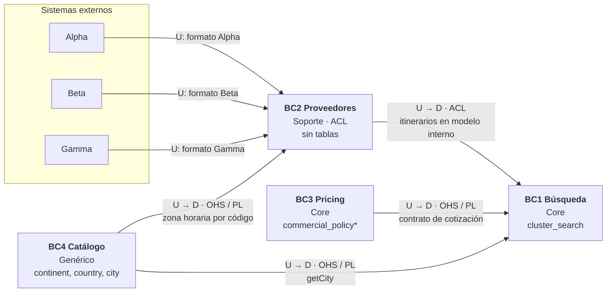
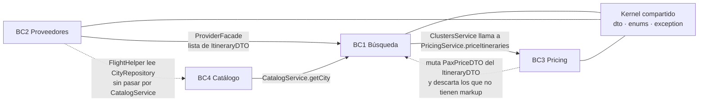
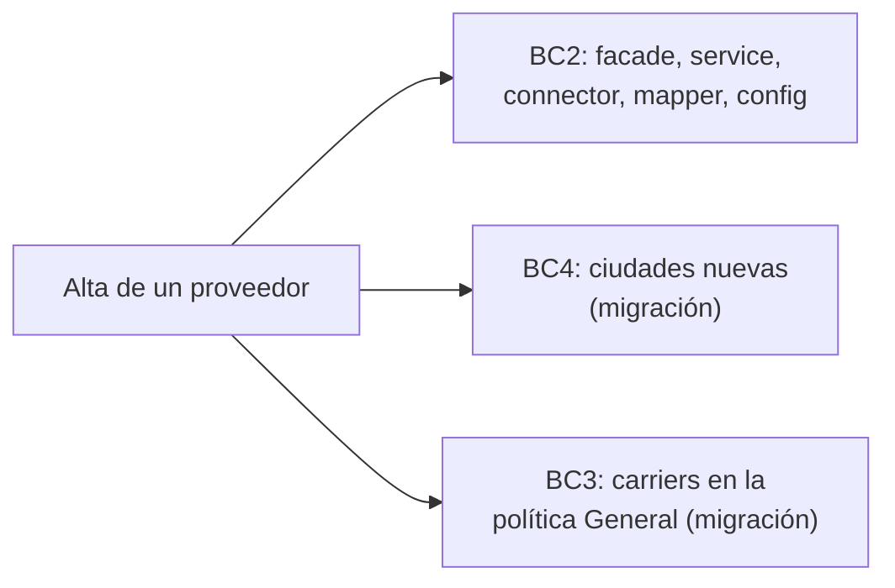

# Context map

Paso 2 de la clase 3. Documenta la división en bounded contexts que aprobó el equipo a partir del
[informe de investigación](informe-investigacion.md). La decisión y sus alternativas están en el
[ADR-001](adr-001-division-en-bounded-contexts.md); el lenguaje de cada contexto, en el
[glosario por contexto](glosario-por-contexto.md), y los conceptos que cruzan límites, en
[entidades compartidas](entidades-compartidas.md).

> Convención de rutas: las clases están en `src/main/java/com/twa/flights/`. Se nombran por paquete y clase.

---

## 1. Contextos

| # | Contexto | Tipo de subdominio | Responsabilidad | Datos propios |
|---|----------|--------------------|-----------------|---------------|
| **BC1** | **Búsqueda de vuelos** (*Shopping*) | Core | Validar el pedido, orquestar la búsqueda, deduplicar, guardar la búsqueda con TTL, filtrar, ordenar y paginar | `cluster_search` |
| **BC2** | **Integración con proveedores** (*Supplier Integration*) | Soporte | Llamar a Alpha, Beta y Gamma y traducir cada formato al modelo interno. Calcular la duración de los vuelos | Ninguna tabla (solo configuración `connector.provider-*`) |
| **BC3** | **Pricing** (cálculo y administración de políticas comerciales) | Core | Elegir la política vigente por carrier, aplicar el markup y administrar las políticas | `commercial_policy`, `commercial_policy_carrier` |
| **BC4** | **Catálogo geográfico** | Genérico | Ciudades con zona horaria, país y continente. Solo lectura; se carga por migraciones | `continent`, `country`, `city` |

Fuera de los contextos queda el **kernel compartido** (`dto`, `enums`, `exception`): no es un dominio, es el
acoplamiento que hay que desarmar (ver [entidades compartidas](entidades-compartidas.md)).

---

## 2. Mapa objetivo

Cómo se van a relacionar los contextos una vez separados. `U` = *upstream* (provee), `D` = *downstream* (consume).

| Relación | Patrón | Qué se intercambia |
|----------|--------|--------------------|
| Proveedores externos → BC2 | **Anticorruption Layer** | Cada proveedor con su formato (centavos, `1PC23KG`, `Y/W/C`, camelCase / snake_case / PascalCase). BC2 lo traduce y no deja pasar ese lenguaje |
| BC2 → BC1 | **Customer / Supplier** (BC1 es el cliente) | Lista de itinerarios ya traducidos y con duración calculada, detrás de la interfaz `ProviderFacade` |
| BC3 → BC1 | **Open Host Service + Published Language** | Contrato de cotización propio: carrier, fechas del vuelo y precio por tipo de pasajero entran; markup por tipo de pasajero sale. BC1 aplica el resultado |
| BC4 → BC1 | **Open Host Service + Published Language** | Consulta de ciudad por código (validación del pedido) |
| BC4 → BC2 | **Open Host Service + Published Language** | Zona horaria de una ciudad por código (cálculo de duración) |

---

## 3. Mapa actual (lo que hay que corregir)

Así se relacionan hoy los contextos dentro del monolito. Las líneas punteadas son las dependencias que no respetan el
mapa objetivo.

| # | Desvío | Evidencia | Cómo se corrige en el mapa objetivo |
|---|--------|-----------|-------------------------------------|
| 1 | **BC2 salta la API de BC4.** El cálculo de duración consulta el repositorio de ciudades directamente, 2 consultas por segmento y 2 por tramo | `helper/FlightHelper` líneas 65-66 y 73-74 (`cityRepository.findByCode`) | BC2 pasa a consumir la API publicada de BC4 |
| 2 | **BC3 se adapta al modelo de BC1 (conformista invertido).** `PricingService` recibe `ItineraryDTO`, lo modifica en el lugar y filtra los que no tienen markup. La `Specification` navega segmentos y tramos | `service/PricingService` líneas 39-53 y 79-90; `specification/CommercialPolicyCarrierSpecification` líneas 45-73 | BC3 publica un contrato de cotización propio y no conoce `ItineraryDTO` |
| 3 | **Kernel compartido.** `ItineraryDTO` aparece en 27 archivos; `ExceptionStatus` mezcla los códigos de todos los contextos | `grep -rl ItineraryDTO`, `enums/ExceptionStatus` | Cada concepto pasa a tener dueño (ver [entidades compartidas](entidades-compartidas.md)) |

---

## 4. Dependencias por datos

Ningún contexto lee las tablas de otro por SQL, salvo el desvío 1. Pero hay **datos semilla que acoplan contextos**:
dar de alta un proveedor (commit `f77c8a1`, Gamma) tocó BC2 y además agregó ciudades (`V1.5`, BC4) y carriers a la
política "General" (`V1.6`, BC3). Sin esas filas, los itinerarios del proveedor nuevo se descartan: sin ciudad no hay
duración (R08) y sin política no hay precio (R02).

Quién es dueño de ese alta es una pregunta abierta (ver [ADR-001](adr-001-division-en-bounded-contexts.md#preguntas-abiertas)).
