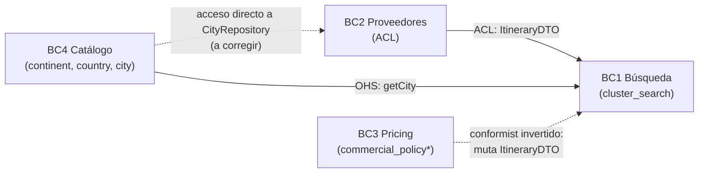

# Informe de investigación: bounded contexts candidatos

Resultado del paso 1 de la clase 3 (solo lectura). Parte del [mapa de módulos](../clase-2-conoce-tu-monolito/mapa-modulos-dependencias.md),
el [glosario](../clase-2-conoce-tu-monolito/glosario.md) y las [reglas ocultas](../clase-2-conoce-tu-monolito/reglas-ocultas.md)
de la clase 2, y se verificó contra el código y las migraciones. Lo que no se pudo comprobar está marcado como
**(hipótesis)**.

> Convención de rutas: las clases están en `src/main/java/com/twa/flights/`. Se nombran por paquete y clase.

**Notas sobre las fuentes:**

- El `analisis-git-log.txt` de esta clase quedó vacío (0 bytes). Para los cambios conjuntos se usó el de la clase 2 y
  `git log` sobre los archivos clave. Conviene regenerarlo antes del paso 2.
- El prompt nombra un módulo "Aerolíneas" que no existe en el código ni en el mapa de la clase 2. Se analiza y se
  descarta como contexto (ver sección 2).

---

## 1. Candidatos

| # | Contexto candidato | Lenguaje propio | Entidades / modelo | Datos propios | Cohesión | Acoplamiento | Evidencia |
|---|---|---|---|---|---|---|---|
| **BC1** | **Búsqueda de vuelos** (*Shopping*). Incluye D1 y D6 (sesión de búsqueda) | búsqueda, *cluster* (= búsqueda guardada), ruta, filtro, orden, página/offset, escalas, franja horaria, deduplicación, TTL | `ClusterSearch` (agregado), `ItineraryDTO` como resultado, `AvailabilityRequestDTO`, `PaginationDTO` | `cluster_search` | **Alta.** Cada feature de búsqueda toca juntos `ClustersResources`, `ClustersAvailabilityRequestDTO`, `AvailabilityRequestValidator` y `ClustersService` (8176f5d, 7245208, b0ee16b) | **Alto hacia afuera:** orquesta a los otros 3 contextos. Ninguno depende de él | `service/ClustersService` (inyecta `PricingService` y `ClustersRepository`), `service/ItinerariesSearchService` (`List<ProviderFacade>`), `validator/AvailabilityRequestValidator` línea 220 (`CatalogService.getCity`), `repository/impl/ClustersRepositoryImpl` (`TOKEN_TTL = 5`, pool propio), `job/ClusterSearchCleanupJob`, `helper/Itinerary{Filter,Sort,KeyGenerator}Helper`, `helper/FlightDuplicationCheckHelper` |
| **BC2** | **Integración con proveedores** (*Supplier Integration*, capa anticorrupción) | *offer / flight option / itinerary*, *journey / bound*, tarifa (*fare*), *availability* por proveedor, formatos propios (centavos, `1PC23KG`, `Y/W/C`) | records de `dto/provider/*`, `ProviderMapperHelper.Fare`, enum `Provider` | **Ninguna tabla**: solo configuración (`connector.provider-*`) | **Alta.** Un proveedor = facade + service + connector + config + mapper + record. f77c8a1 agregó 13 archivos juntos. d0b786a y c0f5987 cambiaron los 3 proveedores a la vez | **Medio.** Hacia afuera expone solo la interfaz `ProviderFacade`. **Tiene un acoplamiento oculto con Catálogo** (ver BC4) | `facade/ProviderFacade`, `facade/Provider*Facade`, `service/Provider*Service`, `connector/*Connector` (hace el HTTP **y** mapea), `mapper/provider/*ItineraryMapper`, `helper/FlightHelper` |
| **BC3** | **Pricing / Políticas comerciales**. Une D3 (cálculo) y D4 (administración) | política comercial, carrier de la política, porcentaje, markup, prioridad, vigencia, activa | `CommercialPolicy` (agregado raíz), `CommercialPolicyCarrier` | `commercial_policy`, `commercial_policy_carrier` (FK entre ellas) | **Alta.** El cálculo y el CRUD usan la misma entidad, el mismo repositorio y las mismas invariantes. `CommercialPolicyService` reutiliza `CommercialPolicyValidator.normalize` | **Alto por modelo, bajo por datos.** No tiene contrato propio: recibe el `ItineraryDTO` de la búsqueda y **lo muta**. La `Specification` navega `SegmentDTO.firstLeg()` | `service/PricingService` (`priceItineraries` cambia `PaxPriceDTO` en el lugar y descarta lo que no tiene markup), `specification/CommercialPolicyCarrierSpecification` (`toPredicate` usa `itinerary.firstSegment()/lastSegment()/getCarrier()`), `service/CommercialPolicyService`, `controller/CommercialPolicyController`, `configuration/PricingApiKeyInterceptor`, `V1.2`, `V1.7` |
| **BC4** | **Catálogo geográfico** (subdominio genérico) | ciudad (en realidad un código IATA de ciudad o aeropuerto), país, continente, zona horaria | `City` → `Country` → `Continent` | `continent`, `country`, `city` | **Alta.** Solo se lee y se carga con migraciones (`V1.0`, `V1.1`, `V1.5`). Un único servicio | **Bajo por API:** solo `AvailabilityRequestValidator` llama a `CatalogService`. **Alto oculto:** `FlightHelper` (BC2) lee `CityRepository.findByCode` directo, 2 consultas por tramo y 2 por segmento | `service/CatalogService`, `repository/CityRepository`, `helper/FlightHelper` (`calculateFlightDuration`) |

### Relaciones entre contextos (hipótesis de context map)

- **BC2 → BC1: capa anticorrupción.** Ya existe de hecho: los mappers traducen el formato de cada proveedor al
  modelo interno.
- **BC4 → BC1 y BC4 → BC2: proveedor con API publicada (*Open Host*).** Hoy BC2 no usa esa API: va directo al
  repositorio.
- **BC3 ↔ BC1: relación invertida.** Pricing debería ser el proveedor (*upstream*), pero hoy se adapta al modelo de
  la búsqueda (*conformist* al revés). Hace falta un contrato propio de cotización.

---

## 2. Qué se descartó y por qué

| Descartado | Por qué |
|---|---|
| **"Aerolíneas" como contexto** | No hay entidad, tabla, servicio ni endpoint. El carrier es un `String` en `ItineraryDTO.carrier`, un `varchar(3)` en `commercial_policy_carrier` (`V1.2`) y un filtro en `ItineraryFilterHelper`. Es un **identificador compartido** (lenguaje publicado), no un contexto. **(Hipótesis)** si negocio necesita un maestro de aerolíneas, aparecería como contexto nuevo o como parte del Catálogo. |
| **Sesión de búsqueda (D6) como contexto propio** | No tiene lenguaje propio. La interfaz `ClustersRepository` recibe y devuelve DTOs de la API (`ClusterSearchDTO`, `ItineraryDTO`), y su ciclo de vida (TTL, limpieza, paginación) es de la búsqueda. Es infraestructura de BC1. |
| **Administración de pricing (D4) separada del cálculo (D3)** | Separarlas obligaría a compartir las tablas o a replicarlas. Las invariantes (porcentaje 0–100, un carrier por política, fechas) son las que el cálculo necesita. Lo que sí es distinto es la **audiencia** (admin con `X-Api-Key` frente a la búsqueda pública). Eso se resuelve con dos APIs dentro del mismo contexto. |
| **Kernel compartido (`dto`, `enums`, `exception`) como contexto** | No es un dominio: es el síntoma de acoplamiento que hay que desarmar (ver sección 3). |

---

## 3. Entidades y conceptos compartidos

| Concepto | Quién lo usa hoy | Dueño propuesto | Problema | Evidencia |
|---|---|---|---|---|
| `ItineraryDTO`, `SegmentDTO`, `LegDTO`, `PriceInfoDTO`, `PaxPriceDTO`, `MarkupDTO` | BC1, BC2, BC3 y la tabla `cluster_search` (como JSON) | **BC1** (es el resultado de la búsqueda). BC2 lo produce traduciendo; BC3 debería recibir un modelo propio (carrier, fechas de vuelo, precios por pasajero) **(hipótesis)** | Lo importan 27 archivos. `PricingService` lo muta en el lugar | `grep ItineraryDTO`; `PricingService.updatePriceInfo` |
| Código de carrier | BC1 (filtros), BC2 (mapeo), BC3 (clave de la política) | Lenguaje publicado. Sin maestro | 3 caracteres en la tabla y 2 en el validador. Un carrier nuevo sin política desaparece (R02) | `V1.2`, `CommercialPolicyValidator`, `PricingService` línea 53 |
| Código de ciudad | BC1 (valida), BC2 (zona horaria), JSON de `cluster_search` | **BC4** | BC2 salta la API del Catálogo | `FlightHelper`, `AvailabilityRequestValidator` línea 220 |
| `Provider` (enum) | BC2 (asigna), BC1 (clave de deduplicación) | **BC2** | Sumar un proveedor toca el kernel | `enums/Provider`, `ItineraryKeyGeneratorHelper` |
| `PassengerType`, `CabinClass` | BC1, BC2, BC3 | Lenguaje publicado | Estables. Riesgo bajo | `enums/*` |
| `ExceptionStatus` | Todos (400_01–400_22 búsqueda, 400_23–400_29 y 404_03–04 pricing, 404_01–02 sesión) | Repartirlo por contexto | Cambió en 6 commits, el archivo más "caliente" | `enums/ExceptionStatus`, git log |
| Id del itinerario | BC2 lo toma del proveedor; BC3 lo usa para cruzar el precio | BC1 (con el proveedor como parte de la clave) | **(Hipótesis no comprobada)** si dos proveedores devuelven el mismo id, `priceItineraries` puede aplicar el markup al itinerario equivocado (cruza por `getId()` con `findFirst`). No se cambió: queda anotado | `PricingService.priceItineraries` |

---

## 4. Señales del git log que respaldan los límites

- **f77c8a1 (proveedor Gamma):** tocó BC2 y además `V1.5` (ciudades, BC4) y `V1.6` (carriers en "General", BC3).
  Sumar un proveedor cruza 3 contextos. Es la mejor prueba de las dependencias por datos.
- **fadab06 ("use the time zone of the cities"):** probablemente es donde nació el acceso de `FlightHelper` a
  `CityRepository` **(hipótesis: falta ver el diff)**.
- **Pricing casi no cambió:** `PricingService` tiene un solo commit (f01d39f). Es un contexto estable y buen candidato
  a tener un contrato propio.

---

## 5. Preguntas abiertas (para revisar con negocio)

1. **¿Cotizar es parte de buscar, o es un servicio que otros también van a usar** (checkout, reprecio)? Eso define si
   BC3 es *upstream* con contrato propio o un paso interno de la búsqueda.
2. **¿Hace falta un maestro de aerolíneas** (nombre, alianzas, estado)? Si no, el carrier sigue siendo solo un código.
3. **¿La "ciudad" es una ciudad o un aeropuerto?** Cambia el lenguaje del Catálogo y la regla de la zona horaria.
4. **¿La zona horaria debería venir del proveedor**, o el Catálogo es la fuente de verdad? Si es el Catálogo, BC2
   tiene que pasar a consumir su API.
5. **¿Quién es dueño del alta de un proveedor?** Hoy implica tocar el catálogo y la política "General" (R02).
6. **¿La búsqueda guardada es un concepto de negocio** (por ejemplo, para compartir un link o retomar la búsqueda)
   **o solo un caché para paginar?** Si es de negocio, podría ganar peso como contexto propio.
7. **Reglas de pricing que condicionan el contrato:** ¿el porcentaje se divide por 10 (R01)? ¿Gana la prioridad más
   alta (R03)? ¿La vigencia se mira por fechas del vuelo o de compra (R04)?
